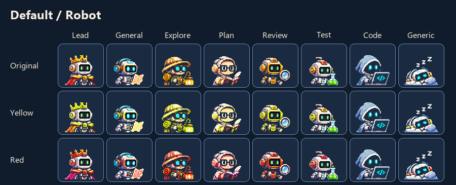
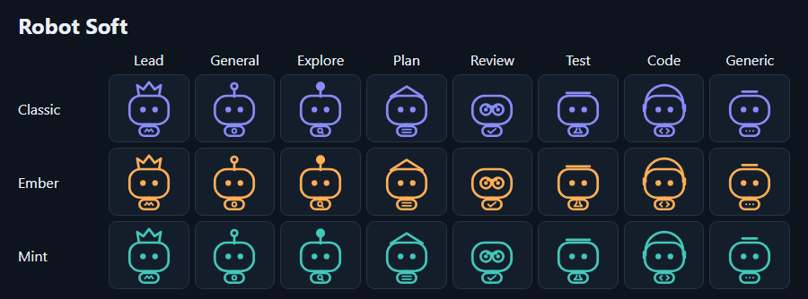
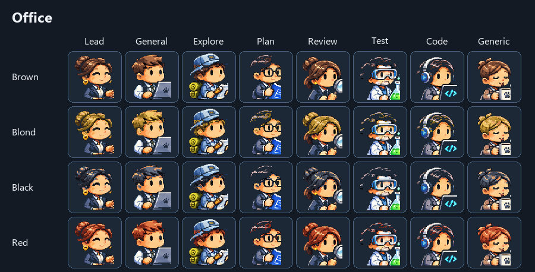
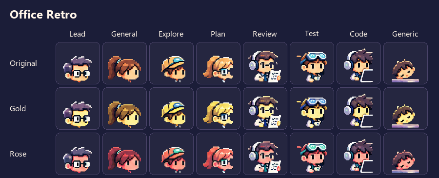
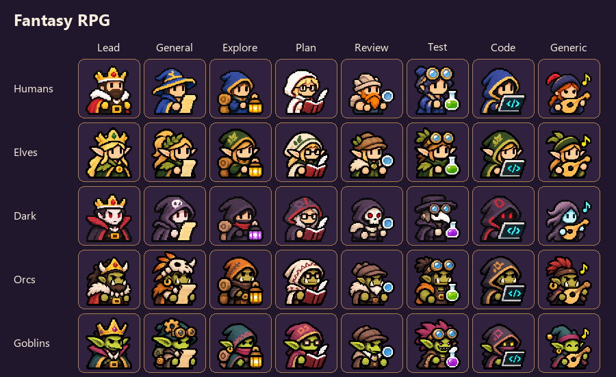
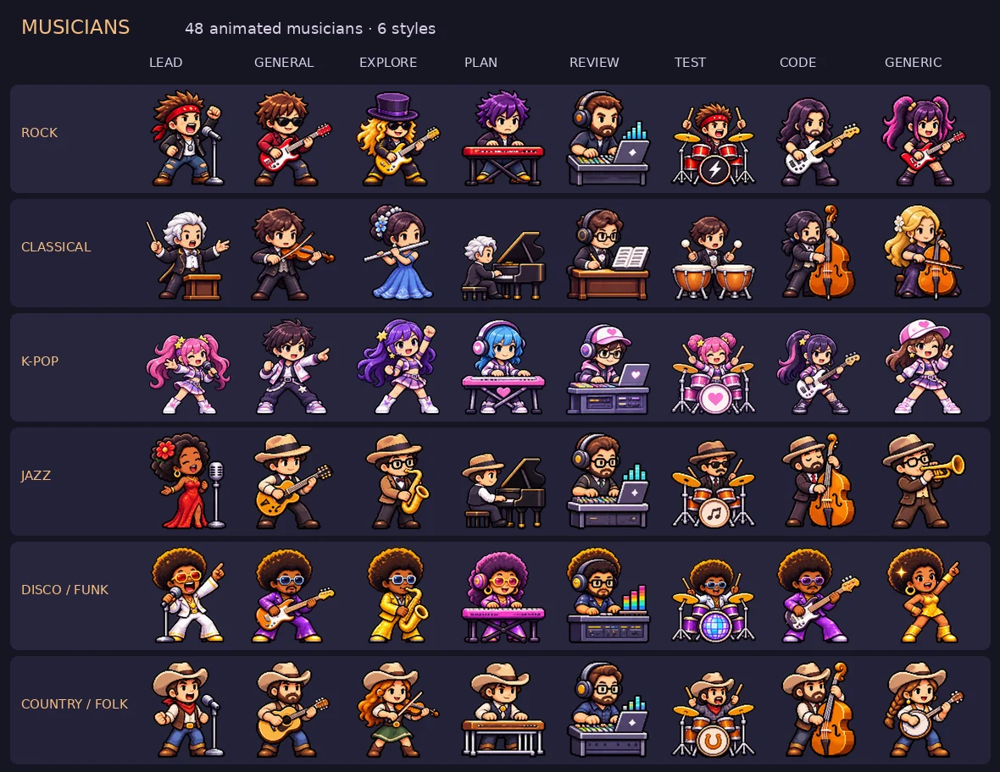

# agentsdash themes

Themes for the [agentsdash](https://github.com/tfabien/agentsdash) page, installed from its Marketplace tab. Each core theme is polished for small screens and demonstrates a different rendering capability.

| Preview | Theme | Format | Showcase |
|---|---|---|---|
|  | **Robot** | PNG sprites | Default pixel-art experience |
|  | **Robot Soft** | SVG | Rounded role avatars, accent tint and working blinks |
|  | **Office** | Lossless WebP | Localized hair palette swaps |
|  | **Office Retro** | PNG sprites | Retro pixel-art alternative |
|  | **Cat Minimal** | PNG sprites | Three complete, small-screen cat looks |
|  | **Fantasy RPG** | PNG sprites | Five genuinely different character teams |
|  | **Musicians** | Animated WebP | 48 performers, six musical genres and intermittent instrument-playing animations |

## Theme capabilities

- **Variants** change interface colors and, when supported, the theme accent.
- **Looks** change character rendering independently of the interface variant.
- **Blink frames** add a short working blink using an optional role-specific sprite.
- **SVG tint** uses `currentColor` with `icons/pack.json`.
- **Palette swaps** replace exact raster colors defined in `icons/pack.json`.
- **Sprite looks** select complete alternate role sprites through `look.sprite`.

## Repository layout

```text
<theme>/theme.json
<theme>/preview.png
<theme>/icons/pack.json                    # optional rendering metadata
<theme>/icons/<role>[-N][-blink].<format>
archive/                                   # preserved, not published
docs/                                      # format reference and creation guide
.claude/skills/create-agentsdash-theme/    # skill for AI assistants
tools/check.mjs                            # marketplace validator
```

The active roles are `lead`, `general`, `explore`, `plan`, `review`, `test`, `code`, and `generic`. The `archive/` directory preserves former themes and source assets but is excluded from Marketplace validation.

Run the collection checker before submitting changes:

```bash
node tools/check.mjs
```

## Documentation

- [install.md](install.md): install from the Marketplace, by API or by hand.
- [docs/create-theme.md](docs/create-theme.md): specification of a new theme (files, `theme.json`, colors, contrast, role pictures, art rules, checks).
- [docs/format.md](docs/format.md): full reference of what the hub accepts (variants, looks, accent, tint modes, palette swaps).

## Generate a theme with an AI assistant

The skill [`.claude/skills/create-agentsdash-theme/SKILL.md`](.claude/skills/create-agentsdash-theme/SKILL.md) holds the whole specification and a step-by-step procedure in one file.

- Claude Code loads it on its own inside a clone of this repository. Ask "create an agentsdash theme about pirates". Copy the folder to `~/.claude/skills/` to use it everywhere.
- Claude.ai takes the folder as an uploaded skill (zip it first).
- ChatGPT and other assistants take `SKILL.md` as project instructions, a custom GPT's instructions or an attached file.
